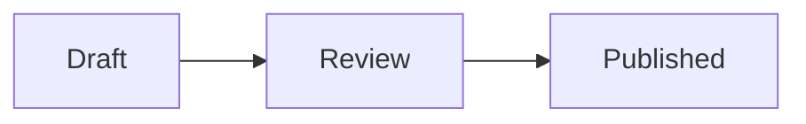

# Lapis rich Markdown syntax

Read this for Lapis/Mira authoring beyond the common Obsidian-compatible subset.
Lapis includes pipe and grid tables, extended task states, list callouts,
directives, code-line controls, math, Mermaid and rich editable previews. Syntax
and editor controls are separate: see [editor capabilities](EDITOR_CAPABILITIES.md)
for defaults and optional features. Treat the installed Lapis renderer as the
contract rather than limiting a note to upstream Obsidian examples.

## Grid tables and spans

Pipe tables support ordinary alignment markers. Grid tables support explicit
boundaries, multiline cells, sections and spanning cells. Keep border widths
aligned when editing; changing one boundary can alter a span.

<!-- prettier-ignore -->
```markdown
+-------------------+------+
| Table Headings    | Here |
+--------+----------+------+
| Sub    | Headings | Too  |
+========+=================+
| cell   | column spanning |
| spans  +---------:+------+
| rows   |   normal | cell |
+---v----+:---------------:+
|        | cells can be    |
|        | *formatted*     |
|        | **paragraphs**  |
|        | ~~~             |
| multi  | and contain     |
| line   | blocks          |
| cells  | ~~~             |
+========+=========:+======+
| footer |    cells |      |
+--------+----------+------+
```

## Directives

Inline :name[content]{attributes}, leaf ::name[content]{attributes}, and container
:::name forms are parsed. Containers can nest using longer outer colon fences.
A generic directive becomes a portable custom element. An installed extension
can supply its rendering; the syntax does not create a new plugin or component.

<!-- prettier-ignore -->
```markdown
:::mira{title="Decision context"}
Use **Markdown** inside the directive body.
:::
```

## Code blocks with line metadata

Lapis supports highlighted line ranges, optional line numbers, a starting line
number and preserving outer blank lines. Preserve the fence language and metadata
when changing code; directives inside a block are still block content.

`<!-- prettier-ignore -->

````markdown
```ts {2,4-6} showLineNumbers=10 keepOuterBlankLine
const first = 1;
const second = 2;
````

````

nolinenumbers disables numbering for that block. A source-language fence is not
an instruction to execute its content.

## Math and diagrams

Use $E = mc^2$ for inline math and a $$ block for display math. Lapis renders
math through KaTeX; use supported LaTeX, not arbitrary TeX packages. Mermaid is
a registered editor extension and is enabled by default unless settings disable it.

`<!-- prettier-ignore -->
```markdown
$$
\sum_{i=1}^{n} i = \frac{n(n+1)}{2}
$$


````

## Other rich content

Footnotes use [^source] and a separate [^source]: definition. Semantic HTML such
as <details>, <summary>, <kbd> and <mark> is supported; raw-HTML policy is
host-controlled. Lapis also renders tags, sized images and extended task markers.
See [callouts and tasks](CALLOUTS_AND_TASKS.md) and [embeds](EMBEDS.md).

Preserve the authoring syntax instead of flattening a rich table, diagram or
callout to plain text. Inspect both Source and Reading/Live Preview when editing
syntax whose layout or renderer matters. Custom extensions may add more
capabilities; do not invent their directive names or configuration.
